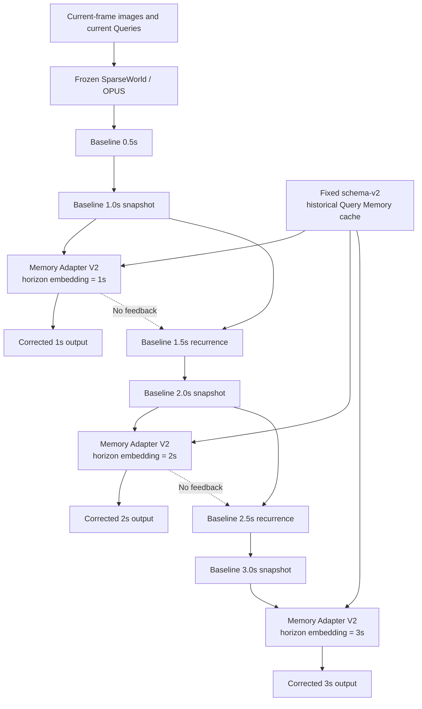
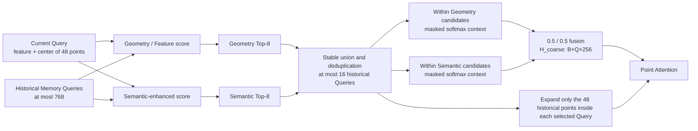
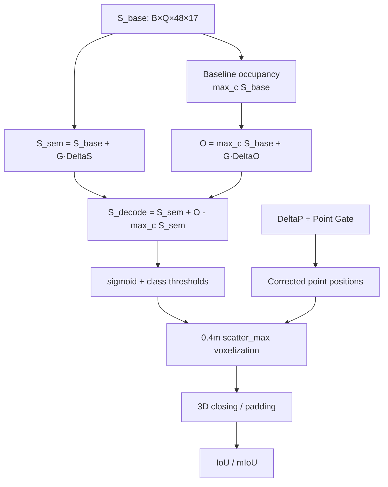

# Future Memory Adapter V2: Modeling and Experimental Issues Report

> Purpose: Explain the current Future Memory Adapter V2 temporal modeling, Memory retrieval,
> output and loss design, and issues actually observed in experiments to collaborators.
>
> Status: The V2 epoch 11/12/13 metrics in this report come from the old experiments before
> the occupancy-target correction. Training of the corrected version has restarted, but no new formal IoU/mIoU results are available yet, so improved metrics cannot be claimed.

## 1. Task Objective and Design Boundaries

The SparseWorld/OPUS Baseline already recurrently generates point and semantic predictions for 0.5s–3.0s into the future.
Future Memory Adapter V2 leaves the Baseline future recurrence unchanged. It reads Baseline snapshots at the three target
horizons of 1s, 2s, and 3s, then applies point-level residual corrections to each horizon's outputs using fixed historical Query Memory.

The design boundaries are:

- All Baseline parameters are frozen and kept in eval mode;
- Only `future_memory_adapter_v2.*` is trained, totaling 1,497,622 parameters;
- The 0s output remains exactly the Baseline;
- The 0.5s, 1.5s, and 2.5s outputs remain the Baseline;
- V2 runs only at 1s, 2s, and 3s;
- Memory corrections are not written back into the Baseline recurrence;
- Logits are not accumulated across horizons;
- With no valid Memory, the output reduces exactly to the Baseline;
- V1 classes, configurations, and checkpoint paths remain separate.

## 2. Overall Temporal Workflow



The Baseline has 6 internal future states:

| internal step | Prediction horizon | Processed by V2 |
|---:|---:|:---:|
| 0 | 0.5s | No |
| 1 | 1.0s | Yes |
| 2 | 1.5s | No |
| 3 | 2.0s | Yes |
| 4 | 2.5s | No |
| 5 | 3.0s | Yes |

At each horizon, the Baseline recurrence roughly performs:

```text
Previous-step Query feature / Query points
    + ego feature cross-attention
    + positional encoding for the current time
    + scheduled queries newly added at this step
    ↓
classification branch
velocity branch
position regression branch
    ↓
Q_base(t), P_base(t), S_base(t)
```

At each target horizon, V2 reads:

```text
Q_base(t): [B,Q_t,256]
P_base(t): [B,Q_t,48,3]
S_base(t): [B,Q_t,48,17]
```

At the default scale, the Query counts at 1s, 2s, and 3s are approximately 840, 960, and 1040. Since corrections only enter
the final output list, the 1s correction does not change the 2s Baseline state, and the 2s correction does not change the 3s state.
However, the three horizons share one set of V2 parameters, so training gradients from all three horizons jointly update the Adapter.

## 3. Historical Memory Source

Memory comes from a schema-v2 cache generated in advance by the frozen Baseline `epoch_56.pth`. During training,
it is neither updated nor regenerated.

Each historical Query stores:

| Contents | shape |
|---|---|
| Query feature | `[256]` |
| Historical points | `[48,3]` |
| Query-level semantic distribution | `[17]` |
| reliability | Scalar |
| base age | Scalar |
| valid mask | Scalar |
| Historical ego2global | `[4,4]` |

By default, three historical timestamps with base ages of approximately 2.5s, 3.5s, and 4.5s are selected. At most 256
Queries are retained per timestamp, so each sample contains at most:

```text
3 × 256 = 768 Memory Queries
```

Historical points are first aligned to the current coordinate system using the historical and current `ego2global` transforms. This removes only ego pose
changes; it does not explicitly extrapolate historical dynamic objects using velocity.

## 4. Effective Age for Future Horizons

The age in the cache is relative only to the current observed frame:

\[
a_{base}=t_{current}-t_{history}
\]

At different prediction horizons, the following is used:

\[
a_{effective}=a_{base}+t_{horizon}
\]

For example:

| base age | 1s effective age | 2s effective age | 3s effective age |
|---:|---:|---:|---:|
| 2.5s | 3.5s | 4.5s | 5.5s |
| 3.5s | 4.5s | 5.5s | 6.5s |
| 4.5s | 5.5s | 6.5s | 7.5s |

`effective_age` is used for:

- Maximum-age filtering, currently capped at 8s;
- The temporal penalty in Query-level coarse retrieval;
- The temporal penalty in Point Attention;
- Support age statistics;
- Point Adapter diagnostic features.

The original cache age is not modified in place.

## 5. Dual-Path Query-Level Coarse Retrieval



### 5.1 Geometry Path

The current Query uses the mean position of its 48 points as the coarse retrieval center. The Geometry path score is:

\[
A^{geometry}_{qm}
=
\frac{Q_qK_m}{\sqrt{256}}
-\frac{d_{qm}^2}{6^2}
-\frac{a^{effective}_m}{8}
+\log(r_m)
\]

Here:

- \(d_{qm}\) is the distance between the current Query center and the historical Query center;
- \(r_m\) is the reliability of the historical Memory;
- Candidates must satisfy `memory_valid=True`;
- `reliability > 0`;
- `0 < effective_age <= 8s`;
- The center distance must not exceed 6m.

This path does not use the current explicit semantic distribution.

### 5.2 Semantic-Enhanced Path

For each current point, first compute:

\[
P_{current}=softmax(S_{base})
\]

Normalized entropy:

\[
U=\frac{H(P_{current})}{\log 17}
\]

Semantic weight:

\[
w_{sem}=\max(0.1,(1-U)^2)
\]

During coarse retrieval, average the semantic distributions of the 48 current points, then compute compatibility with the historical Query semantic distribution:

\[
compat=P^{query}_{current}\cdot P^{query}_{memory}
\]

The Semantic path score is:

\[
A^{semantic}
=
A^{geometry}
+w_{sem}\log(compat)
\]

In training mode, Semantic Dropout is applied with a 10% probability: only the current semantics used as retrieval conditions are replaced with a uniform
distribution, and the semantic weight is reduced to 0.1. Baseline logits are not modified, and dropout is disabled during evaluation.

### 5.3 Dual-Path Candidates and Coarse Context Within Candidates

Each path selects its own Top-8, followed by stable deduplication:

\[
\mathcal U_q=
TopK(A^{geometry})\cup TopK(A^{semantic})
\]

At most 16 historical Queries are retained per current Query. Duplicate candidates appear only once; invalid, expired, and out-of-radius
Memory does not enter subsequent computation.

Each path applies masked softmax within its own candidate slots:

\[
H_g=\sum_{m\in U_g}\alpha^g_mV_m
\]

\[
H_s=\sum_{m\in U_s}\alpha^s_mV_m
\]

When both paths have candidates:

\[
H_{coarse}=0.5H_g+0.5H_s
\]

When only one path is valid, its full Context is used. The current implementation does not perform mean/sum/max pooling over all Memory Queries,
so unselected Memory cannot leak into `H_coarse`.

## 6. Point-Level Local Retrieval

Each coarse candidate contains 48 historical points, so one current Query expands to at most:

```text
16 historical Queries × 48 points = 768 historical points
```

Point Attention is computed in chunks of current Queries. The configuration defaults to `query_chunk_size=40`, while the current training command
uses 48, so the main attention score shape is:

```text
[B,48,48,8,768]
```

The dimensions correspond to batch, current Query chunk, points within each current Query, attention heads, and candidate historical points.
No global matrix between all current points and all historical points is constructed.

### 6.1 Point Query

Of the 8 attention heads, the first 4 are geometry-only heads and the last 4 are semantic-enhanced
heads.

Geometry heads:

\[
X^{geo}_{q,r}
=W_qQ_q+PE(P_{q,r})+E_h+H_g(q)
\]

Semantic heads:

\[
X^{sem}_{q,r}
=W_qQ_q+PE(P_{q,r})+E_h+H_{coarse}(q)
+W_sP^{current}_{q,r}
\]

### 6.2 Historical Point Key/Value

The historical Query feature is broadcast to its 48 points, while each historical point retains its own positional encoding:

\[
K^{geo}_{m,j}=K_m+W_kM_m+PE(P_{m,j})
\]

Semantic heads additionally incorporate historical semantics:

\[
K^{sem}_{m,j}=K^{geo}_{m,j}+W_sP^{memory}_m
\]

The schema-v2 cache currently contains only Query-level historical semantics, so the semantic distribution of each historical Query is broadcast to
its 48 points.

### 6.3 Point Attention Scores

The base Point score is:

\[
A_{q,r,m,j}
=
\frac{X_{q,r}K_{m,j}}{\sqrt d}
-\frac{\|P_{q,r}-P_{m,j}\|^2}{6^2}
-\frac{a^{effective}_m}{8}
+\log(r_m)
\]

Semantic heads additionally include:

\[
w_{sem}(q,r)
\log(P^{current}_{q,r}\cdot P^{memory}_m)
\]

Geometry heads do not use an explicit semantic term and can read only geometry coarse candidates; Semantic heads read
the deduplicated candidate union. Each head for each current point finally selects Point Top-8 and applies masked softmax:

\[
H_{q,r}
=Concat_h\left(\sum_{m,j}\alpha^h_{q,r,m,j}V^h_{m,j}\right)
\]

The multi-head Context is concatenated, without division by the number of heads. The final outputs are:

```text
Point Memory Context: [B,Q,48,256]
Point Gate:           [B,Q,48,1]
```

Both are exactly 0 when no candidates are available.

## 7. Per-Point Semantic Disagreement Features

Each current point retains its own point-level Baseline semantics:

```text
P_current: [B,Q,48,17]
```

Weighting candidate historical semantics through Point Attention gives:

```text
P_memory:  [B,Q,48,17]
```

The Point Adapter explicitly receives:

```text
P_current
P_memory
P_current - P_memory
cosine_similarity(P_current, P_memory)
JS_divergence(P_current, P_memory)
current entropy
top1-top2 margin
semantic weight
```

Semantic disagreement is not used as a hard mask to remove candidates. The design intent is to allow Memory that is "spatially close, similar in features, and highly reliable,
but semantically different from the current Baseline" to serve as evidence for correction.

## 8. Point Adapter Inputs and Outputs

The Adapter input for each current point is:

| Feature | Dimensions |
|---|---:|
| Query feature | 256 |
| Current point position embedding | 256 |
| Point Memory Context | 256 |
| Query feature - Context | 256 |
| horizon embedding | 256 |
| `P_current` | 17 |
| `P_memory` | 17 |
| `P_current-P_memory` | 17 |
| 10 scalar diagnostic features | 10 |
| Total | 1341 |

The 10 scalars, in order, are:

```text
eligible point count / capacity
selected point count / point_topk
support reliability
effective support age / max_age
support distance / point_radius
semantic uncertainty
semantic margin
semantic weight
semantic cosine
semantic JS divergence
```

Adapter MLP:

```text
1341 → 512 → 256
```

Outputs:

```text
delta_semantic:  [B,Q,48,17]
delta_occupancy: [B,Q,48,1]
delta_position:  [B,Q,48,3]
point_gate:      [B,Q,48,1]
```

The Point Gate bias is initialized to `-1`, giving an initial sigmoid value of approximately 0.269. The final layer of all three residual heads is
zero-initialized, so the initial forward pass equals the Baseline exactly. When there are no valid candidates, the gate and all residuals are 0.

## 9. Decoupling Semantics, Occupancy, and Decoding



The formulas are:

\[
S_{sem}=S_{base}+G\Delta S
\]

\[
O=\max_c(S_{base})+G\Delta O
\]

\[
S_{decode}=S_{sem}+\left(O-\max_c(S_{sem})\right)
\]

This guarantees:

```text
argmax(S_decode) == argmax(S_sem)
max(S_decode) == O
```

Class ranking is determined only by the semantic branch, while the occupancy branch determines whether the final class threshold is crossed.
The position branch uses the relative encoding change of metric residuals. With zero residuals, a gate of 0, or no candidates, the output position Tensor
is exactly equal to the Baseline.

## 10. Training Losses

V2 applies the following losses only at 1s, 2s, and 3s:

| Loss | Weight |
|---|---:|
| `loss_base_cls` | 1.00 |
| `loss_pts` | 0.50 |
| `loss_sem` | 0.25 |
| `loss_occ` | 0.25 |
| `loss_occ_anchor` | 0.05 |
| `loss_threshold` | 0.10 |
| `loss_soft_voxel` | 0.10 |

### 10.1 Occupancy Targets

The corrected version defines predicted points as positive samples if:

1. The predicted point lies inside a nonempty GT voxel;
2. Or its distance to the center of a nonempty GT voxel does not exceed half the voxel's three-dimensional diagonal.

For a 0.4m cube:

\[
r=0.5\sqrt{0.4^2+0.4^2+0.4^2}=0.3464m
\]

`loss_occ` and `loss_threshold` compute separate means for the positive and negative groups, then combine them according to the
configuration. This prevents the numerically dominant negative samples from suppressing occupancy for all future points.

A Baseline occupancy anchor has been added:

\[
L_{occ\_anchor}
=SmoothL1\left(O,\max_c(S_{base})\right)
\]

Its weight is 0.05, to suppress global recall collapse caused by the independent occupancy branch.

### 10.2 Threshold Loss

Class probability thresholds are read from `pts_bbox_head.test_cfg.score_thr`:

```text
First 15 classes: 0.35
16th class: 0.25
17th class: 0.30
```

After converting thresholds to logit space, a softplus margin loss is applied separately to positive and negative samples.

### 10.3 Sparse SoftVoxel Loss

Each predicted point is distributed trilinearly to the surrounding 8 voxels according to its continuous coordinates:

\[
P_{i,c}=\sigma(O_i)softmax(S_{sem,i})_c
\]

The contributions are then aggregated with a noisy-OR formulation, and class-wise Soft-IoU is computed only over the sparse union of predicted voxels and nonempty GT voxels.

## 11. Training GPU Memory Strategy

Point Attention runs at 1s, 2s, and 3s. To run on two 24GB RTX 3090 GPUs, the current setup uses:

- A batch size of 1 per GPU;
- A Query chunk size of 48;
- V2 activation checkpointing enabled;
- CPU saved-tensor offload disabled;
- FP16 dynamic loss scaling;
- Reuse of Point key/value/position projection results within the same forward pass.

Activation checkpointing does not change the model formulas, but re-executes the V2 forward pass during backward, thereby
reducing GPU memory usage at the cost of additional training time.

## 12. Issues Already Observed in Experiments

### 12.1 The Initial Implementation Could Not Complete the First Iteration on a 24GB GPU

Early on, even with:

```text
samples_per_gpu=1
query_chunk_size=1
```

OOM still occurred in Point Attention historical-point positional encoding, value construction, or attention scores. At the time of the errors,
each GPU had already allocated approximately 20.6–22.9GiB, with only a few MiB to tens of MiB remaining.

The main causes were:

- The frozen Baseline forward pass itself already consumed substantial GPU memory;
- Separate Point Attention computation graphs were retained for 1s, 2s, and 3s;
- Historical-point feature normalization and position projection were previously recomputed repeatedly;
- The Adapter MLP previously constructed the entire `[B,Q,48,1341]` activation for all Queries at once.

Corrections already applied:

- Both Point Attention and the Adapter MLP are computed in Query chunks;
- Historical-point normalized features, positional encodings, and key/value intermediate results are reused;
- Activation checkpointing is used for V2;
- Large diagnostics computation graphs are not returned during training;
- The final q48 configuration can reliably start training.

### 12.2 Training Is Significantly Slower Than V1/Baseline

Typical iteration times for the corrected training run are approximately 3.3–3.5 seconds, with occasional larger fluctuations; 16 epochs
are expected to take approximately 6–7 days. The main costs are:

```text
One Query coarse-retrieval pass for each of three horizons
+ Three Point Attention passes
+ Three Point Adapter passes
+ Three recomputations during backward due to activation checkpointing
```

This is not a DataLoader bottleneck: `data_time` in the logs is typically around 0.03 seconds. Most of the time is spent on GPU model
computation and checkpoint recomputation.

### 12.3 V2 Metrics Before the Occupancy Correction Dropped Sharply at Later Future Horizons

Formal dump-based evaluation results for the old V2 q48 experiment are:

| checkpoint | 0s IoU/mIoU | 1s IoU/mIoU | 2s IoU/mIoU | 3s IoU/mIoU |
|---|---:|---:|---:|---:|
| epoch 11 | 25.68 / 18.20 | 20.19 / 13.05 | 19.23 / 11.05 | 17.88 / 9.19 |
| epoch 12 | 25.68 / 18.20 | 19.91 / 12.66 | 19.12 / 10.78 | 17.81 / 8.99 |
| epoch 13 | 25.68 / 18.20 | 20.43 / 13.24 | 19.38 / 11.12 | 17.99 / 9.21 |

The Future Mean for epoch 13 is approximately:

```text
IoU Future Mean  = 19.2667
mIoU Future Mean = 11.1900
```

The known Baseline Future Mean is approximately:

```text
IoU Future Mean  = 22.2133
mIoU Future Mean = 13.2233
```

The retained formal V1 results are: epoch 4 mIoU Future Mean of 13.2500 (+0.0267 relative to the
Baseline), and epoch 6 IoU Future Mean of 22.2467 (+0.0333 relative to the Baseline). These
values are used only to show that the old V2 results were clearly abnormal; V2 has not overwritten the V1 code, configuration, or checkpoints.

Thus, old V2 epoch 13 is clearly below the Baseline. All three checkpoints have identical 0s results, indicating that the degradation is concentrated in
the V2 target future steps, rather than resulting from damage to 0s or the shared Evaluator.

### 12.4 The Main Symptom of Old V2 Is Future Occupancy Recall Collapse

Occupancy statistics from a sample of 80 examples in the old epoch 11 evaluation dump:

| Horizon | Predicted nonempty voxels per sample | Nonempty GT voxels per sample | precision | recall | occupancy IoU |
|---:|---:|---:|---:|---:|---:|
| 0s | 59032.4 | 38293.1 | 0.3416 | 0.5266 | 0.2614 |
| 1s | 32920.8 | 38363.8 | 0.3782 | 0.3246 | 0.2116 |
| 2s | 30474.2 | 38275.3 | 0.3863 | 0.3075 | 0.2066 |
| 3s | 28237.5 | 37969.0 | 0.3912 | 0.2909 | 0.2003 |

The symptom is not a large number of false positives, but a continuous decline in predicted nonempty voxel counts and recall as the horizon increases. Precision
rises slightly, indicating that old V2 becomes increasingly conservative by removing predicted occupancy.

### 12.5 The Old Occupancy Positive-Sample Definition Was Found to Be Inconsistent with 0.4m Voxel Evaluation

The old implementation used:

```text
Distance from the predicted point to the nearest nonempty GT voxel center <= 0.20m
```

However, a point inside a 0.4m cube can be as far from the center as:

\[
0.5\sqrt{0.4^2+0.4^2+0.4^2}=0.3464m
\]

Thus, even if a point already lies inside the correct nonempty GT voxel, it may still be labeled as a negative sample by
`loss_occ` and `loss_threshold` if it is near a voxel corner. Position errors are larger at future horizons, making this error
more pronounced at 2s and 3s.

The independent occupancy branch satisfies:

```text
max(S_decode) = O
```

Once many points are incorrectly supervised as negatives, a decrease in `O` pushes all classes of each point below threshold together. This is consistent with
the experimental observation that "class precision rises slightly, but occupancy recall drops sharply."

The current code has been corrected as follows:

- Points inside nonempty GT voxels are unconditionally treated as positive samples;
- The supplementary neighborhood radius is changed to half the voxel's three-dimensional diagonal, 0.3464m;
- Positive and negative samples are averaged separately;
- A Baseline occupancy anchor has been added.

### 12.6 No Formal Metrics Are Available Yet for the Corrected Version

The corrected version has restarted training from the frozen Baseline `epoch_56.pth`. For example, in the logs at 2026-10-01 14:00 UTC,
epoch 1 had reached approximately iteration 750/9865, losses remained finite, and `grad_norm` was approximately
0.63–0.72, with no NaNs or OOMs.

At present, this only shows that the corrected version can start training; it does not show that its IoU/mIoU has recovered. The old epoch 11–13
checkpoints were trained with incorrect occupancy targets. Updating the code cannot automatically fix them, and they should not be
used to resume training of the corrected version.

### 12.7 Full Evaluation Places Pressure on Host Memory

The original temporal test workflow accumulates large numbers of voxel predictions in the main process, which can place substantial pressure on host
memory during long evaluations. Epoch 11/12/13 evaluations were completed by dumping results per sample first, then aggregating metrics separately.
This changes only how results are collected; it does not change the model forward pass or the Evaluator's definitions of IoU/mIoU.

## 13. Current Conclusions

The current V2 implementation is a two-stage Query-to-Point historical Memory output corrector that does not feed back into the future recurrence.
The old experiments have shown that the code can train and evaluate, but the old occupancy supervision causes clear future recall collapse,
leading to severe degradation of the 2s and 3s metrics.

The occupancy positive-sample definition, positive/negative balance, and Baseline occupancy anchor have been corrected, and training is now restarting
from the Baseline. Whether the corrected version is effective must be judged jointly by subsequent 1s/2s/3s precision, recall, predicted
nonempty voxel counts, IoU, and mIoU, rather than by training loss alone.

## 14. Core Code Locations

- `mmdet3d/models/sparsedetectors/query_memory.py`
  - `FutureMemoryAdapterV2`
  - Query coarse retrieval, Point Attention, Point Adapter
  - Semantic/occupancy decoupling
  - Occupancy targets and SoftVoxel loss
- `mmdet3d/models/sparsedetectors/sparseworld_4d_traj.py`
  - Baseline future recurrence
  - V2 integration at 1s/2s/3s
  - Recurrence isolation and loss aggregation
- `mmdet3d/models/sparsedetectors/opus_head.py`
  - Final sigmoid, class thresholds, voxelization, scatter-max, and 3D closing
- `mmdet3d/datasets/pipelines/loading_query_memory.py`
  - Fixed schema-v2 cache loading and historical timestamp selection
- `configs/sparseworld/nuscenes-temporal/sparseworld-traj-memory-future-adapter-v2.py`
  - V2 retrieval, attention, loss, and training parameters
