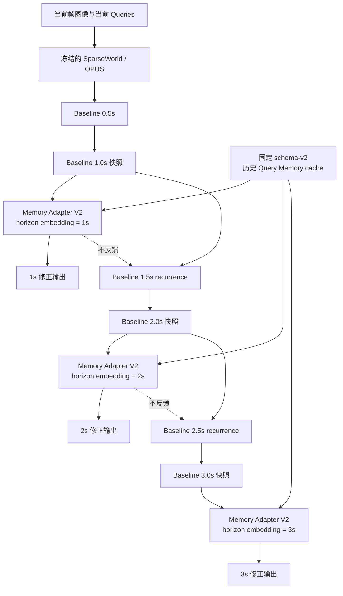
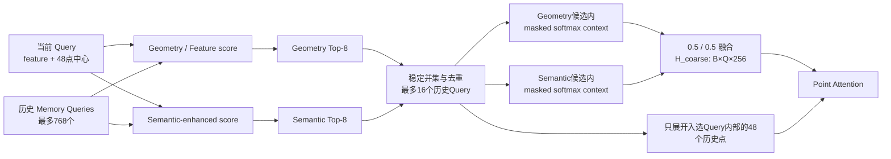
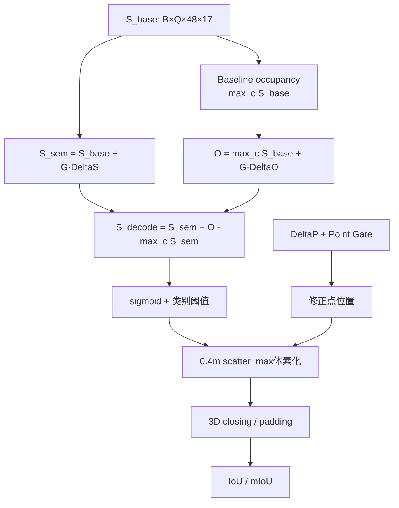

# Future Memory Adapter V2 建模与实验问题汇报

> 用途：向合作者说明当前 Future Memory Adapter V2 的时序建模、Memory 检索、
> 输出与损失设计，以及实验中已经实际出现的问题。
>
> 状态说明：本文中的 V2 epoch 11/12/13 指标来自 occupancy 目标修正前的旧实验；
> 修正版已经重新开始训练，但目前尚无新的正式 IoU/mIoU 结果，不能据此声称指标提升。

## 1. 任务目标与设计边界

SparseWorld/OPUS Baseline 已经能够递推生成未来 0.5s～3.0s 的点和语义预测。
Future Memory Adapter V2 不修改 Baseline 的未来递推，而是在 1s、2s、3s 三个目标
时刻读取 Baseline 快照，再使用固定历史 Query Memory 对该时刻的输出做点级残差修正。

设计边界如下：

- Baseline 参数全部冻结并保持 eval mode；
- 只训练 `future_memory_adapter_v2.*`，共 1,497,622 个参数；
- 0s 完全保持 Baseline；
- 0.5s、1.5s、2.5s 保持 Baseline；
- 只在 1s、2s、3s 执行 V2；
- Memory 修正结果不写回 Baseline recurrence；
- 不存在跨时刻 logits 累加；
- 无有效 Memory 时严格退化为 Baseline；
- V1 类、配置和 checkpoint 路径保持独立。

## 2. 总体时序流程



Baseline 内部共有6个未来状态：

| internal step | 预测时刻 | 是否经过 V2 |
|---:|---:|:---:|
| 0 | 0.5s | 否 |
| 1 | 1.0s | 是 |
| 2 | 1.5s | 否 |
| 3 | 2.0s | 是 |
| 4 | 2.5s | 否 |
| 5 | 3.0s | 是 |

每个时刻的 Baseline recurrence 大致执行：

```text
上一时刻 Query feature / Query points
    + ego feature cross-attention
    + 当前时间的位置编码
    + 该时刻新加入的 scheduled queries
    ↓
classification branch
velocity branch
position regression branch
    ↓
Q_base(t), P_base(t), S_base(t)
```

V2 在目标时刻读取：

```text
Q_base(t): [B,Q_t,256]
P_base(t): [B,Q_t,48,3]
S_base(t): [B,Q_t,48,17]
```

默认规模下，1s、2s、3s 的 Query 数量约为 840、960、1040。由于修正结果只进入
最终输出列表，1s 修正不会改变 2s Baseline state，2s 修正也不会改变 3s state。
不过三个 horizon 共用同一套 V2 参数，因此三个时刻的训练梯度会共同更新 Adapter。

## 3. 历史 Memory 来源

Memory 来自冻结 Baseline `epoch_56.pth` 预先生成的 schema-v2 cache，训练过程中
不更新，也不会重新生成。

每个历史 Query 保存：

| 内容 | shape |
|---|---|
| Query feature | `[256]` |
| 历史点 | `[48,3]` |
| Query级语义分布 | `[17]` |
| reliability | 标量 |
| base age | 标量 |
| valid mask | 标量 |
| 历史 ego2global | `[4,4]` |

默认选择基础年龄约为 2.5s、3.5s、4.5s 的三个历史时刻，每个时刻最多保留256个
Query，因此每个样本最多包含：

```text
3 × 256 = 768 Memory Queries
```

历史点首先通过历史与当前 `ego2global` 对齐到当前坐标系。这一步只消除自车位姿
变化，不对历史动态目标做显式速度外推。

## 4. 面向未来时刻的 Effective Age

Cache 中的年龄只相对于当前观测帧：

\[
a_{base}=t_{current}-t_{history}
\]

在不同预测 horizon 中使用：

\[
a_{effective}=a_{base}+t_{horizon}
\]

例如：

| base age | 1s effective age | 2s effective age | 3s effective age |
|---:|---:|---:|---:|
| 2.5s | 3.5s | 4.5s | 5.5s |
| 3.5s | 4.5s | 5.5s | 6.5s |
| 4.5s | 5.5s | 6.5s | 7.5s |

`effective_age` 用于：

- 最大年龄筛选，当前上限为8s；
- Query级粗检索时间惩罚；
- Point Attention时间惩罚；
- support age统计；
- Point Adapter诊断特征。

原始 cache age 不会被原地修改。

## 5. Query级双路粗检索



### 5.1 Geometry路径

当前 Query 使用48个点的平均位置作为粗检索中心。Geometry路径分数为：

\[
A^{geometry}_{qm}
=
\frac{Q_qK_m}{\sqrt{256}}
-\frac{d_{qm}^2}{6^2}
-\frac{a^{effective}_m}{8}
+\log(r_m)
\]

其中：

- \(d_{qm}\) 是当前 Query 中心和历史 Query 中心之间的距离；
- \(r_m\) 是历史 Memory reliability；
- 候选必须满足 `memory_valid=True`；
- `reliability > 0`；
- `0 < effective_age <= 8s`；
- 中心距离不超过6m。

该路径不使用当前显式语义分布。

### 5.2 Semantic增强路径

当前每个点先计算：

\[
P_{current}=softmax(S_{base})
\]

归一化熵：

\[
U=\frac{H(P_{current})}{\log 17}
\]

语义权重：

\[
w_{sem}=\max(0.1,(1-U)^2)
\]

粗检索时将48个当前点的语义分布求平均，并与历史 Query 语义分布计算兼容性：

\[
compat=P^{query}_{current}\cdot P^{query}_{memory}
\]

Semantic路径分数为：

\[
A^{semantic}
=
A^{geometry}
+w_{sem}\log(compat)
\]

训练模式以10%概率执行 Semantic Dropout：只把检索条件中的当前语义替换为均匀
分布，并将语义权重降到0.1；不会修改 Baseline logits，evaluation 中关闭。

### 5.3 双路候选与候选内粗Context

两条路径分别选择 Top-8，再稳定去重：

\[
\mathcal U_q=
TopK(A^{geometry})\cup TopK(A^{semantic})
\]

每个当前 Query 最多保留16个历史 Query。重复候选只保留一次，无效、过期和半径外
Memory 不会进入后续计算。

两条路径在自己的候选槽内分别做 masked softmax：

\[
H_g=\sum_{m\in U_g}\alpha^g_mV_m
\]

\[
H_s=\sum_{m\in U_s}\alpha^s_mV_m
\]

两条路径都有候选时：

\[
H_{coarse}=0.5H_g+0.5H_s
\]

只有一条路径有效时使用该路径的完整 Context。当前实现中不存在对全部 Memory Query
的 mean/sum/max 池化，未入选 Memory 不会泄漏到 `H_coarse`。

## 6. Point级局部检索

每个粗候选包含48个历史点，因此一个当前 Query 最多展开：

```text
16个历史Query × 48点 = 768个历史点
```

Point Attention 按当前 Query 分块计算。配置默认 `query_chunk_size=40`，当前训练命令
使用48，因此主要 attention score shape 为：

```text
[B,48,48,8,768]
```

分别对应 batch、当前Query chunk、当前Query内部点、attention head和候选历史点。
没有构造全部当前点与全部历史点之间的全局矩阵。

### 6.1 Point Query

8个attention heads中，前4个是geometry-only heads，后4个是semantic-enhanced
heads。

Geometry heads：

\[
X^{geo}_{q,r}
=W_qQ_q+PE(P_{q,r})+E_h+H_g(q)
\]

Semantic heads：

\[
X^{sem}_{q,r}
=W_qQ_q+PE(P_{q,r})+E_h+H_{coarse}(q)
+W_sP^{current}_{q,r}
\]

### 6.2 历史Point Key/Value

历史 Query feature 广播到其48个点，但每个历史点保留自己的位置编码：

\[
K^{geo}_{m,j}=K_m+W_kM_m+PE(P_{m,j})
\]

Semantic heads额外加入历史语义：

\[
K^{sem}_{m,j}=K^{geo}_{m,j}+W_sP^{memory}_m
\]

schema-v2 cache 目前只有 Query级历史语义，因此同一历史 Query 的语义分布会广播到
其48个点。

### 6.3 Point Attention分数

基础Point分数为：

\[
A_{q,r,m,j}
=
\frac{X_{q,r}K_{m,j}}{\sqrt d}
-\frac{\|P_{q,r}-P_{m,j}\|^2}{6^2}
-\frac{a^{effective}_m}{8}
+\log(r_m)
\]

Semantic heads额外加入：

\[
w_{sem}(q,r)
\log(P^{current}_{q,r}\cdot P^{memory}_m)
\]

Geometry heads不使用显式语义项，并且只能读取geometry粗候选；Semantic heads读取
去重后的候选并集。每个当前点、每个head最终选择Point Top-8并做masked softmax：

\[
H_{q,r}
=Concat_h\left(\sum_{m,j}\alpha^h_{q,r,m,j}V^h_{m,j}\right)
\]

多头Context是拼接，不除以head数量。最终：

```text
Point Memory Context: [B,Q,48,256]
Point Gate:           [B,Q,48,1]
```

无候选时二者严格为0。

## 7. 逐点语义分歧特征

当前点保留自己的逐点 Baseline 语义：

```text
P_current: [B,Q,48,17]
```

通过Point Attention对候选历史语义加权，得到：

```text
P_memory:  [B,Q,48,17]
```

Point Adapter显式接收：

```text
P_current
P_memory
P_current - P_memory
cosine_similarity(P_current, P_memory)
JS_divergence(P_current, P_memory)
current entropy
top1-top2 margin
semantic weight
```

语义不一致不会作为hard mask删除候选。设计意图是让“空间近、特征相似、可靠性高，
但与当前Baseline语义不同”的Memory成为纠错线索。

## 8. Point Adapter输入与输出

每个当前点的Adapter输入为：

| 特征 | 维度 |
|---|---:|
| Query feature | 256 |
| 当前点position embedding | 256 |
| Point Memory Context | 256 |
| Query feature - Context | 256 |
| horizon embedding | 256 |
| `P_current` | 17 |
| `P_memory` | 17 |
| `P_current-P_memory` | 17 |
| 10个标量诊断特征 | 10 |
| 合计 | 1341 |

10个标量依次为：

```text
eligible point count / capacity
selected point count / point_topk
support reliability
effective support age / max_age
support distance / point_radius
semantic uncertainty
semantic margin
semantic weight
semantic cosine
semantic JS divergence
```

Adapter MLP：

```text
1341 → 512 → 256
```

输出：

```text
delta_semantic:  [B,Q,48,17]
delta_occupancy: [B,Q,48,1]
delta_position:  [B,Q,48,3]
point_gate:      [B,Q,48,1]
```

Point Gate bias 初始化为 `-1`，初始 sigmoid 约为0.269；三个残差头的最后一层全部
零初始化，所以初始前向严格等于 Baseline。无有效候选时 gate 和所有残差均为0。

## 9. Semantic、Occupancy和Decode解耦



公式为：

\[
S_{sem}=S_{base}+G\Delta S
\]

\[
O=\max_c(S_{base})+G\Delta O
\]

\[
S_{decode}=S_{sem}+\left(O-\max_c(S_{sem})\right)
\]

从而保证：

```text
argmax(S_decode) == argmax(S_sem)
max(S_decode) == O
```

类别排序只由 semantic 分支决定，是否越过最终类别阈值由 occupancy 分支决定。
位置分支使用米制残差的相对编码变化；零残差、gate为0或无候选时，输出位置Tensor
严格等于 Baseline。

## 10. 训练损失

V2只对1s、2s、3s接入以下损失：

| 损失 | 权重 |
|---|---:|
| `loss_base_cls` | 1.00 |
| `loss_pts` | 0.50 |
| `loss_sem` | 0.25 |
| `loss_occ` | 0.25 |
| `loss_occ_anchor` | 0.05 |
| `loss_threshold` | 0.10 |
| `loss_soft_voxel` | 0.10 |

### 10.1 Occupancy目标

修正版将以下预测点定义为正样本：

1. 预测点落入GT非空体素；
2. 或距离GT非空体素中心不超过半体素三维对角线。

对于0.4m立方体：

\[
r=0.5\sqrt{0.4^2+0.4^2+0.4^2}=0.3464m
\]

`loss_occ`和`loss_threshold`分别计算正样本组内均值与负样本组内均值，再按配置
融合，避免数量占优的负样本把所有未来点的occupancy压低。

新增Baseline occupancy锚定：

\[
L_{occ\_anchor}
=SmoothL1\left(O,\max_c(S_{base})\right)
\]

其权重为0.05，用于抑制独立 occupancy 分支造成的全局召回塌缩。

### 10.2 Threshold loss

类别概率阈值从 `pts_bbox_head.test_cfg.score_thr` 读取：

```text
前15类：0.35
第16类：0.25
第17类：0.30
```

阈值转换到logit空间后，对正负样本分别施加softplus margin loss。

### 10.3 Sparse SoftVoxel loss

每个预测点按连续坐标向周围8个体素做三线性分配：

\[
P_{i,c}=\sigma(O_i)softmax(S_{sem,i})_c
\]

再通过noisy-OR形式聚合，只在预测体素和GT非空体素的稀疏并集上计算逐类Soft-IoU。

## 11. 训练显存策略

1s、2s、3s都会执行Point Attention。为了在两张24GB RTX 3090上运行，当前采用：

- 每GPU batch size为1；
- Query chunk size为48；
- V2 activation checkpoint开启；
- CPU saved-tensor offload关闭；
- FP16 dynamic loss scale；
- Point key/value/position projection结果在同一次forward中复用。

Activation checkpoint不会改变模型公式，但在backward时会重新执行V2 forward，因此
减少显存的同时会增加训练时间。

## 12. 实验中已经出现的问题

### 12.1 初始实现无法在24GB GPU上完成第一个iteration

早期即使设置：

```text
samples_per_gpu=1
query_chunk_size=1
```

仍会在Point Attention的历史点位置编码、value构造或attention score处OOM。报错时
每张卡已经分配约20.6～22.9GiB，只剩数MiB到几十MiB。

主要原因是：

- 冻结 Baseline forward 本身已经占用大量显存；
- 1s、2s、3s分别保留Point Attention计算图；
- 历史点feature normalization、position projection曾被重复计算；
- Adapter MLP曾一次性构造全部Query的 `[B,Q,48,1341]` 激活。

已经采取的修正：

- Point Attention和Adapter MLP都按Query chunk计算；
- 复用历史点的normalized feature、position encoding和key/value中间结果；
- 对V2使用activation checkpoint；
- 训练时不返回大型diagnostics计算图；
- 最终q48配置可以稳定进入训练。

### 12.2 训练速度明显慢于V1/Baseline

修正版训练的常见iteration时间约为3.3～3.5秒，并存在更高的偶发波动；16个epoch
预计需要约6～7天。主要耗时来自：

```text
三个horizon各执行一次Query粗检索
+ 三次Point Attention
+ 三次Point Adapter
+ activation checkpoint在backward中的三次重计算
```

这不是DataLoader瓶颈：日志中的 `data_time` 通常约0.03秒，主要时间消耗在GPU模型
计算和checkpoint重算。

### 12.3 occupancy修正前的V2指标随未来时刻严重下降

旧V2 q48实验的正式dump评估结果如下：

| checkpoint | 0s IoU/mIoU | 1s IoU/mIoU | 2s IoU/mIoU | 3s IoU/mIoU |
|---|---:|---:|---:|---:|
| epoch 11 | 25.68 / 18.20 | 20.19 / 13.05 | 19.23 / 11.05 | 17.88 / 9.19 |
| epoch 12 | 25.68 / 18.20 | 19.91 / 12.66 | 19.12 / 10.78 | 17.81 / 8.99 |
| epoch 13 | 25.68 / 18.20 | 20.43 / 13.24 | 19.38 / 11.12 | 17.99 / 9.21 |

epoch 13的Future Mean约为：

```text
IoU Future Mean  = 19.2667
mIoU Future Mean = 11.1900
```

已知 Baseline Future Mean约为：

```text
IoU Future Mean  = 22.2133
mIoU Future Mean = 13.2233
```

保留的V1正式结果为：epoch 4的mIoU Future Mean为13.2500（相对Baseline
+0.0267），epoch 6的IoU Future Mean为22.2467（相对Baseline +0.0333）。这些
数值只用于说明旧V2结果明显异常，V1代码、配置和checkpoint没有被V2覆盖。

即旧V2 epoch 13明显低于Baseline。三个checkpoint的0s完全相同，说明下降集中发生在
V2目标future steps，而不是0s或公共Evaluator被破坏。

### 12.4 旧V2的主要现象是未来occupancy recall塌缩

对旧epoch 11评估dump抽样80个样本进行占据统计：

| 时刻 | 每样本预测非空体素 | 每样本GT非空体素 | precision | recall | occupancy IoU |
|---:|---:|---:|---:|---:|---:|
| 0s | 59032.4 | 38293.1 | 0.3416 | 0.5266 | 0.2614 |
| 1s | 32920.8 | 38363.8 | 0.3782 | 0.3246 | 0.2116 |
| 2s | 30474.2 | 38275.3 | 0.3863 | 0.3075 | 0.2066 |
| 3s | 28237.5 | 37969.0 | 0.3912 | 0.2909 | 0.2003 |

表现不是大量假阳性，而是预测非空体素数量和recall随着horizon持续下降。precision
略有上升，说明旧V2越来越保守地删除预测占据。

### 12.5 已定位到旧occupancy正样本定义与0.4m体素评估不一致

旧实现使用：

```text
预测点到最近GT非空体素中心的距离 <= 0.20m
```

但0.4m立方体内的点到中心最远可以达到：

\[
0.5\sqrt{0.4^2+0.4^2+0.4^2}=0.3464m
\]

因此，一个点即使已经落入正确的GT非空体素，只要靠近体素角落，仍可能被
`loss_occ`和`loss_threshold`标记为负样本。未来时刻位置误差更大，所以该错误对
2s、3s的影响更明显。

独立occupancy分支满足：

```text
max(S_decode) = O
```

当大量点被错误监督为负样本后，`O`下降会把该点所有类别一起压到阈值以下。这与
实验中观察到的“类别precision略升，但occupancy recall大幅下降”一致。

当前代码已经修正为：

- GT非空体素内的点无条件视为正样本；
- 邻近补充半径改为半体素三维对角线0.3464m；
- 正负样本分别求均值；
- 新增Baseline occupancy anchor。

### 12.6 修正版尚无正式指标

修正版已从冻结 Baseline `epoch_56.pth` 重新开始训练。以2026-10-01 14:00 UTC的
日志为例，epoch 1进行到约750/9865 iteration，loss保持有限，`grad_norm`约为
0.63～0.72，未出现NaN或OOM。

当前只能说明修正版能够进入训练，不能说明其IoU/mIoU已经恢复。旧epoch 11～13
checkpoint是在错误occupancy目标下训练得到的，不能通过更新代码自动修复，也不应
作为修正版继续resume。

### 12.7 完整评估存在主机内存压力

原始temporal test流程会在主进程中累计大量体素预测，长时间评估可能产生较高主机
内存压力。目前采用先按样本dump，再独立聚合metrics的方式完成epoch 11/12/13评估。
该变化只影响结果收集方式，不改变模型forward和Evaluator的IoU/mIoU计算定义。

## 13. 当前结论

V2当前实现的是一个不反馈到未来递推的、两阶段Query-to-Point历史Memory输出修正器。
旧实验已经证明代码可以训练和评估，但旧occupancy监督会造成明显的未来召回塌缩，
导致2s、3s指标严重下降。

occupancy正样本定义、正负样本平衡和Baseline occupancy anchor已经修正，目前正在从
Baseline重新训练。修正版是否有效，必须以后续1s/2s/3s的precision、recall、预测
非空体素数量、IoU和mIoU共同判断，不能只依据训练loss。

## 14. 核心代码位置

- `mmdet3d/models/sparsedetectors/query_memory.py`
  - `FutureMemoryAdapterV2`
  - Query粗检索、Point Attention、Point Adapter
  - semantic/occupancy解耦
  - occupancy target与SoftVoxel loss
- `mmdet3d/models/sparsedetectors/sparseworld_4d_traj.py`
  - Baseline future recurrence
  - 1s/2s/3s V2接线
  - recurrence隔离与loss汇总
- `mmdet3d/models/sparsedetectors/opus_head.py`
  - 最终sigmoid、类别阈值、体素化、scatter-max和3D closing
- `mmdet3d/datasets/pipelines/loading_query_memory.py`
  - schema-v2固定cache加载和历史时刻选择
- `configs/sparseworld/nuscenes-temporal/sparseworld-traj-memory-future-adapter-v2.py`
  - V2检索、attention、损失和训练参数
